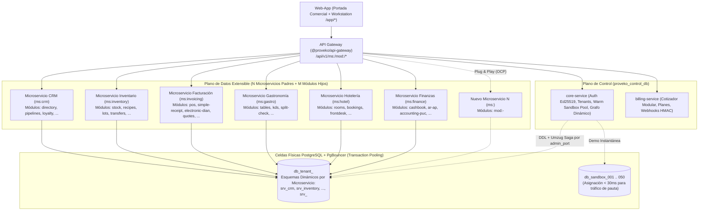

# Proveko — El Servicio SaaS Modular Multi-Tenant de Alto Rendimiento

**Proveko** es **el Servicio empresarial SaaS completo**, multi-tenant y multi-sucursal construido en **100% TypeScript bajo Arquitectura Hexagonal y Principios SOLID**, diseñado para escalar ante tráfico masivo y adaptarse a cualquier giro de negocio mediante una arquitectura abierta de **`N` Microservicios Contenedores** y **`M` Módulos Funcionales**.

---

## 1. Jerarquía Abierta de 3 Niveles: El Servicio -> `N` Microservicios -> `M` Módulos

En **Proveko**, la jerarquía arquitectónica y de negocio se estructura en **3 niveles abiertos y extensibles** (soportando tanto la notación canónica `ms:<dominio>` / `mod:<dominio>-<modulo>` como `srv:<dominio>` / `ms:<dominio>-<modulo>`):

1. **Nivel 1 — El Servicio (La Plataforma SaaS Completa): `Proveko`**
   - Es el sistema empresarial completo integrado por el API Gateway, el Plano de Control (`core-service` + `billing-service`), la aplicación web (`web-app`) y el plano de datos multi-tenant.
2. **Nivel 2 — Microservicios Contenedores (`ms:<dominio>` | alias `srv:<dominio>`):**
   - El sistema soporta **`N` Microservicios Padres ilimitados** (ej. `ms:crm`, `ms:inventory`, `ms:invoicing`, `ms:gastro`, `ms:hotel`, `ms:finance`, y cualquier nuevo vertical futuro como `ms:payroll`, `ms:ecommerce`, `ms:logistics`, `ms:medical`, `ms:<nuevo-dominio>`).
   - Cada Microservicio Padre es un contenedor independiente con su propio esquema de base de datos aislado (`srv_<dominio>` / `ms_<dominio>`) y su propio `host-runner`.
   - **Regla del Microservicio Padre Gatekeeper:** Activar únicamente un Microservicio Padre sin ningún módulo hijo habilita el contenedor pero no expone pantallas operativas. Es requisito obligatorio que el Microservicio Padre esté activo para activar o ejecutar cualquiera de sus Módulos hijos; apagar el Microservicio Padre corta en cascada todos sus Módulos hijos.
3. **Nivel 3 — Módulos Funcionales (`mod:<dominio>-<modulo>` | alias `ms:<dominio>-<modulo>`):**
   - Dentro de cada Microservicio Padre pueden conectarse **`M` Módulos Funcionales ilimitados**.
   - Cada Módulo posee su propio prefijo de tablas y su propia **Arquitectura Hexagonal SOLID** (`domain.ts`, `application.ts`, `infrastructure.ts`, `index.ts`), pudiendo ejecutarse embebido en el `host-runner` de su Microservicio Padre o extraerse a un servidor dedicado propio sin tocar una sola línea de código.



---

## 2. Principios SOLID y Arquitectura Hexagonal en Cada Módulo

Todos los módulos del ecosistema (tanto los del catálogo inicial como cualquier nuevo módulo que se agregue) siguen los **5 Principios SOLID**:

- **`S` — Single Responsibility Principle (SRP):** Cada módulo se divide en 4 archivos con responsabilidad única:
  1. `src/domain.ts`: Entidades, Value Objects, cálculos puros con `MoneyDecimal` (`NUMERIC(19,4)`), validaciones de invariantes de negocio y definición del puerto `RepositoryPort`.
  2. `src/application.ts`: Casos de uso (`*UseCases`) que orquestan el dominio recibiendo únicamente la abstracción `RepositoryPort`.
  3. `src/infrastructure.ts`: Adaptadores concretos de persistencia (`InMemory*RepositoryAdapter` / Adaptador SQL multi-tenant aislado por `tenantId`).
  4. `src/index.ts`: Punto de composición HTTP/Plugin (`build*Plugin(repository)` y `createStandalone*Server`).
- **`O` — Open/Closed Principle (OCP):** El sistema está **abierto a la extensión** (agregar nuevos Microservicios Padres `ms:<dominio>` y nuevos Módulos `mod:<dominio>-<modulo>`) y **cerrado a la modificación** (sin alterar el motor del API Gateway, el `DoubleKeyServiceGuard` ni el `ParentServiceHostRunner`).
- **`L` — Liskov Substitution Principle (LSP):** Cualquier implementación de `RepositoryPort`, `RateLimiterPort`, `TokenVerifierPort`, `WebhookInboxRepositoryPort` o `UpstreamHttpClientPort` es 100% intercambiable sin alterar las invariantes de salida ni los códigos de error `RFC 9457`.
- **`I` — Interface Segregation Principle (ISP):** Puertos segregados por capacidad (`TokenVerifierPort`, `MonotonicSubVerReader`, `CartStoragePort`, `SubscriptionQuoteCalculatorPort`, `WebhookInboxRepositoryPort`).
- **`D` — Dependency Inversion Principle (DIP):** Ningún caso de uso instancia adaptadores ni estado mutable en memoria directamente; todo depende de interfaces/puertos inyectados por constructor.

---

## 3. Cómo Distribuir Microservicios y Módulos en Diferentes Servidores

El repositorio permite empezar con **1 o pocos servidores** (usando el `host-runner` de cada Microservicio Padre) y **extraer cualquier Módulo individual o cualquier nuevo Microservicio a su propio servidor/VPS dedicado** sin cambiar ni una línea de código:

1. **Nivel 1 — Servidor Dedicado para un Módulo Específico (`UPSTREAM_MOD_<MODULO>` o `UPSTREAM_MS_<MODULO>`):**
   ```bash
   # En el API Gateway:
   UPSTREAM_MOD_INVOICING_ELECTRONIC_DIAN=http://10.10.0.30:4199
   ```
2. **Nivel 2 — Servidor Agrupado por Microservicio Padre (`UPSTREAM_MS_<MICROSERVICIO>` / `UPSTREAM_SRV_<MICROSERVICIO>` + `ENABLED_MICROSERVICES`):**
   ```bash
   # En el API Gateway:
   UPSTREAM_MS_INVOICING=http://10.10.0.20:4100

   # En el Servidor 2 (Host-Runner del Microservicio de Facturación excluyendo DIAN):
   ENABLED_MICROSERVICES=mod:invoicing-pos,mod:invoicing-simple-receipt,mod:invoicing-quotes
   ```

---

## 4. Cómo Agregar un Nuevo Microservicio Padre (`ms:<dominio>`) o un Nuevo Módulo (`mod:<dominio>-<modulo>`)

Proveko no está limitado a un número fijo de microservicios ni módulos. Para incorporar un nuevo Microservicio Padre (ej. `ms:payroll` para Nómina Electrónica o `ms:logistics` para Flotas) o un nuevo Módulo dentro de un Microservicio existente:

1. **Registrar la definición en el Catálogo del Grafo (`@proveko/shared-kernel`):**
   - Si es un nuevo **Microservicio Padre (`ms:<dominio>`)**, declarar su clave, esquema PostgreSQL (`srv_<dominio>`) y orden de visualización.
   - Si es un nuevo **Módulo (`mod:<dominio>-<modulo>`)**, declarar su `parentService`, `tablePrefix` (ej. `pay_`), `requiresServices`, `requiresMicroservices`, `mutexGroup` (opcional) y `supersedes` (opcional).
2. **Crear la carpeta del Módulo con las 4 capas Hexagonales SOLID (`apps/srv-<dominio>/ms-<dominio>-<modulo>/src/`):**
   - `domain.ts` (Entidades, validaciones con `MoneyDecimal` y `*RepositoryPort`)
   - `application.ts` (`*UseCases`)
   - `infrastructure.ts` (`pgSchema('srv_<dominio>')` + Adaptador de repositorio)
   - `index.ts` (`defineProvekoModule` + `createStandalone*Server`)
3. **Montarlo en el `host-runner` o en su propio Servidor Dedicado:**
   - El API Gateway enruta automáticamente `/api/v1/ms:<dominio>/mod:<dominio>-<modulo>/*` hacia el `host-runner` (`UPSTREAM_MS_<DOMINIO>`) o hacia su VPS dedicado (`UPSTREAM_MOD_<DOMINIO>_<MODULO>`).

---

## 5. Mapa del Monorepo y Catálogo Base Inicial (Extensible a `N` Microservicios y `M` Módulos)

### Anillo 0 — Librerías Compartidas (`/libs/*`)
- `@proveko/shared-kernel`: Catálogo dinámico del grafo (`ms:*` / `mod:*` y `srv:*` / `ms:*`), `MoneyDecimal` aislado con `Decimal.clone`, claims JWT y errores `RFC 9457`.
- `@proveko/crypto-vault`: Sobre criptográfico `KEK + DEK` (`AES-256-GCM`) y firma/verificación `Ed25519`.
- `@proveko/service-guard`: Guard Zero-Trust de Doble Llave (`TokenVerifierPort`), `AsyncLocalStorage`, `StandaloneMicroserviceServer` y `ParentServiceHostRunner`.
- `@proveko/tenant-db-resolver`: Esquemas explícitos `pgSchema('srv_*')` y micro-pools LRU libres de condiciones de carrera con *Graceful Drain*.
- `@proveko/event-bus`: Patrón Transactional Outbox Híbrido + Transactional Inbox idempotente.
- `@proveko/rules-engine`: Validador anti-JSONB Bomb y protección anti-SSRF (incluyendo IPv4-mapped IPv6 `::ffff:*`) para Webhooks.
- `@proveko/ui-kit`: Reconciliador resiliente del carrito POS ante actualizaciones de `sub_ver` en caliente.

### Anillo 1 — Gateway, Plano de Control y Frontend (`/apps/*`)
- [API Gateway (`apps/api-gateway`)](./apps/api-gateway/README.md)
- [Core Service (`apps/control-plane/core-service`)](./apps/control-plane/core-service/README.md)
- [Billing Service (`apps/control-plane/billing-service`)](./apps/control-plane/billing-service/README.md)
- [Web App (`apps/web-app`)](./apps/web-app/README.md)

### Anillo 2 — Catálogo Base Inicial de Microservicios Padres y Módulos Funcionales

> **Nota de Extensibilidad:** La siguiente tabla lista los microservicios y módulos base pre-construidos en el monorepo; el catálogo admite la incorporación continua de nuevos Microservicios Padres (`ms:<dominio>`) y nuevos Módulos (`mod:<dominio>-<modulo>`).

| Microservicio Padre (`ms:*` / `srv:*`) | Esquema BD | Módulo Funcional (`mod:*` / `ms:*`) | Prefijo Tablas | Documentación |
| :--- | :--- | :--- | :---: | :--- |
| **[`ms:crm` (`srv:crm`)](./apps/srv-crm/README.md)** | `srv_crm` | `mod:crm-directory` | `dir_` | [Ver README](./apps/srv-crm/ms-crm-directory/README.md) |
| | `srv_crm` | `mod:crm-pipelines` | `pip_` | [Ver README](./apps/srv-crm/ms-crm-pipelines/README.md) |
| | `srv_crm` | `mod:crm-loyalty` | `loy_` | [Ver README](./apps/srv-crm/ms-crm-loyalty/README.md) |
| **[`ms:inventory` (`srv:inventory`)](./apps/srv-inventory/README.md)** | `srv_inventory` | `mod:inventory-stock` | `stk_` | [Ver README](./apps/srv-inventory/ms-inventory-stock/README.md) |
| | `srv_inventory` | `mod:inventory-recipes` | `rec_` | [Ver README](./apps/srv-inventory/ms-inventory-recipes/README.md) |
| | `srv_inventory` | `mod:inventory-lots` | `lot_` | [Ver README](./apps/srv-inventory/ms-inventory-lots/README.md) |
| | `srv_inventory` | `mod:inventory-transfers` | `trf_` | [Ver README](./apps/srv-inventory/ms-inventory-transfers/README.md) |
| **[`ms:invoicing` (`srv:invoicing`)](./apps/srv-invoicing/README.md)** | `srv_invoicing` | `mod:invoicing-pos` | `pos_` | [Ver README](./apps/srv-invoicing/ms-invoicing-pos/README.md) |
| | `srv_invoicing` | `mod:invoicing-simple-receipt` | `rcp_` | [Ver README](./apps/srv-invoicing/ms-invoicing-simple-receipt/README.md) |
| | `srv_invoicing` | `mod:invoicing-electronic-dian` | `dian_` | [Ver README](./apps/srv-invoicing/ms-invoicing-electronic-dian/README.md) |
| | `srv_invoicing` | `mod:invoicing-quotes` | `quo_` | [Ver README](./apps/srv-invoicing/ms-invoicing-quotes/README.md) |
| **[`ms:gastro` (`srv:gastro`)](./apps/srv-gastro/README.md)** | `srv_gastro` | `mod:gastro-tables` | `tbl_` | [Ver README](./apps/srv-gastro/ms-gastro-tables/README.md) |
| | `srv_gastro` | `mod:gastro-kds` | `kds_` | [Ver README](./apps/srv-gastro/ms-gastro-kds/README.md) |
| | `srv_gastro` | `mod:gastro-split-check` | `spl_` | [Ver README](./apps/srv-gastro/ms-gastro-split-check/README.md) |
| **[`ms:hotel` (`srv:hotel`)](./apps/srv-hotel/README.md)** | `srv_hotel` | `mod:hotel-rooms` | `rom_` | [Ver README](./apps/srv-hotel/ms-hotel-rooms/README.md) |
| | `srv_hotel` | `mod:hotel-bookings` | `bkg_` | [Ver README](./apps/srv-hotel/ms-hotel-bookings/README.md) |
| | `srv_hotel` | `mod:hotel-frontdesk` | `fdk_` | [Ver README](./apps/srv-hotel/ms-hotel-frontdesk/README.md) |
| **[`ms:finance` (`srv:finance`)](./apps/srv-finance/README.md)** | `srv_finance` | `mod:finance-cashbook` | `csh_` | [Ver README](./apps/srv-finance/ms-finance-cashbook/README.md) |
| | `srv_finance` | `mod:finance-ar-ap` | `arp_` | [Ver README](./apps/srv-finance/ms-finance-ar-ap/README.md) |
| | `srv_finance` | `mod:finance-accounting-puc` | `puc_` | [Ver README](./apps/srv-finance/ms-finance-accounting-puc/README.md) |
| **`ms:<nuevo-dominio>` (`srv:<nuevo-dominio>`)** | `srv_<nuevo_dominio>` | `mod:<nuevo-dominio>-<modulo>` | `<pref>_` | *Extensible mediante `defineProvekoModule` (OCP)* |

---

## 6. Comandos de Desarrollo y Verificación

```bash
# Levantar infraestructura base (PostgreSQL Control Plane + Celda 01 + PgBouncer + Redis + NATS)
docker compose -f infra/docker/docker-compose.yml up -d

# Verificación estricta de tipos TypeScript en todo el monorepo
npm run typecheck

# Ejecutar suite completa de pruebas de auditoría SOLID, Hexagonal e Integración (Vitest)
npm test
```
