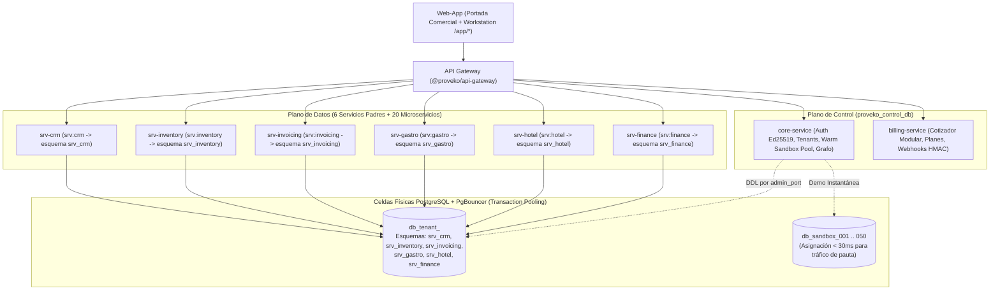

# Proveko — Plataforma SaaS Modular Multi-Tenant de Alto Rendimiento

**Proveko** (del latín *Provehere / Provectus*: impulsar hacia adelante) es un ecosistema empresarial SaaS modular, multi-tenant y multi-sucursal construido bajo el **Modelo de Ingeniería Estilo Alegra (100% TypeScript)**, diseñado específicamente para escalar ante tráfico masivo de pauta publicitaria y adaptarse a múltiples giros de negocio (Bares/Restaurantes, Comercios/Ferreterías DIAN, Hoteles/Alojamiento, Distribuidoras/Farmacias FEFO) mediante la activación granular de **Servicios Padres (`srv:*`)** y **Microservicios Hijos (`ms:*`)**.

---

## 1. Arquitectura General del Sistema



### Pilares Arquitectónicos Clave
1. **Persistencia Multi-Tenant (`Database-per-Tenant + Schema-per-Service`):**
   - Cada empresa cliente tiene su propia base de datos aislada (`db_tenant_<id>`) alojada en una **Celda Física (`DatabaseCell`)**.
   - Dentro de esa base de datos, cada **Servicio Padre** posee su propio esquema PostgreSQL exclusivo (`srv_crm`, `srv_inventory`, `srv_invoicing`, `srv_gastro`, `srv_hotel`, `srv_finance`) declarado explícitamente con `pgSchema('srv_*')` en **Drizzle ORM** para inmunidad total frente a **PgBouncer (`transaction pooling`)**.
   - Las credenciales de base de datos se protegen con **Cifrado por Sobre (*Envelope Encryption KEK + DEK* `AES-256-GCM` + `AAD`)** en `@proveko/crypto-vault`.
2. **Regla de la Doble Llave (Servicio Padre Gatekeeper + Microservicio Hijo):**
   - **El Servicio Padre (`srv:*`) es una compuerta contenedora (*Gatekeeper*):** habilitar únicamente un Servicio Padre (ej. `srv:inventory`) sin ningún microservicio hijo no expone pantallas operativas, pero **es requisito obligatorio** tener habilitado el Servicio Padre para activar o ejecutar cualquiera de sus Microservicios hijos (`ms:*`).
   - Desactivar un Servicio Padre bloquea instantáneamente en cascada todos sus Microservicios hijos en el API Gateway y en `@proveko/service-guard`.
3. **Motor de Relaciones del Grafo (`requires`, `mutex_group`, `supersedes` y `READONLY_ARCHIVE`):**
   - **`requires` y `reverse_requires`:** Impide activar un microservicio sin sus prerrequisitos e impide desactivar un microservicio si otro módulo activo depende de él.
   - **`mutex_group` (Exclusión Mutua):** Garantiza que en un grupo excluyente (como `fiscal_document_emitter` o `accounting_ledger_engine`) solo exista un emisor activo a la vez.
   - **`supersedes` + `READONLY_ARCHIVE`:** Cuando un cliente evoluciona (ej. activa `ms:invoicing-electronic-dian` que reemplaza a `ms:invoicing-simple-receipt`, o activa `ms:finance-accounting-puc` que reemplaza a `ms:finance-cashbook`), el microservicio anterior pasa automáticamente a **`READONLY_ARCHIVE`**: permite consultas históricas (`GET/HEAD`) pero bloquea escrituras (`POST/PUT/PATCH/DELETE` con `403 ERR_MICROSERVICE_READONLY_ARCHIVE`).
4. **Precisión Financiera Estricta (`decimal.js`):**
   - Prohibido usar `number` nativo para dinero, impuestos o cantidades de inventario. Todo cálculo usa `MoneyDecimal` (`NUMERIC(19, 4)` con redondeo comercial `ROUND_HALF_UP`).

---

## 2. Cómo Distribuir Servicios y Microservicios en Diferentes Servidores

El repositorio está diseñado para que puedas empezar con **1 o pocos servidores** (usando los `host-runner` de cada Servicio Padre) y **separar cualquier Microservicio individual en su propio servidor/VPS dedicado** sin cambiar ni una línea de código:

1. **Nivel 1 — Servidor Dedicado por Microservicio (`UPSTREAM_MS_<MICROSERVICE>`):**
   - Si un microservicio específico (por ejemplo, `ms:invoicing-electronic-dian`) requiere un servidor propio, lo levantas usando su `createStandalone*Server` y defines en el API Gateway:
     ```bash
     UPSTREAM_MS_INVOICING_ELECTRONIC_DIAN=http://10.10.0.30:4199
     ```
2. **Nivel 2 — Servidor Agrupado por Servicio Padre (`UPSTREAM_SRV_<SERVICE>` + `ENABLED_MICROSERVICES`):**
   - El resto de microservicios hermanos corren en el `host-runner` de su Servicio Padre:
     ```bash
     # En el API Gateway:
     UPSTREAM_SRV_INVOICING=http://10.10.0.20:4100

     # En el Servidor 2 (Host-Runner de Facturación sin DIAN):
     ENABLED_MICROSERVICES=ms:invoicing-pos,ms:invoicing-simple-receipt,ms:invoicing-quotes
     ```

---

## 3. Mapa Completo del Monorepo y Documentación por Servicio / Microservicio

### Anillo 0 — Librerías Compartidas (`/libs/*`)
- `@proveko/shared-kernel`: Catálogo maestro del grafo, `MoneyDecimal` (`decimal.js`), claims JWT y errores `RFC 9457`.
- `@proveko/crypto-vault`: Sobre criptográfico `KEK + DEK` (`AES-256-GCM`) y firma/verificación `Ed25519`.
- `@proveko/service-guard`: Guard Zero-Trust de Doble Llave, `AsyncLocalStorage`, `StandaloneMicroserviceServer` y `ParentServiceHostRunner`.
- `@proveko/tenant-db-resolver`: Esquemas explícitos `pgSchema('srv_*')` y micro-pools LRU con *Graceful Drain*.
- `@proveko/event-bus`: Patrón Transactional Outbox Híbrido + Transactional Inbox idempotente.
- `@proveko/rules-engine`: Validador anti-JSONB Bomb y protección anti-SSRF para Webhooks.
- `@proveko/ui-kit`: Reconciliador resiliente del carrito POS ante actualizaciones de `sub_ver` en caliente.

### Anillo 1 — Gateway, Plano de Control y Frontend (`/apps/*`)
- [API Gateway (`apps/api-gateway`)](./apps/api-gateway/README.md)
- [Core Service (`apps/control-plane/core-service`)](./apps/control-plane/core-service/README.md)
- [Billing Service (`apps/control-plane/billing-service`)](./apps/control-plane/billing-service/README.md)
- [Web App (`apps/web-app`)](./apps/web-app/README.md)

### Anillo 2 — Los 6 Servicios Padres y sus 20 Microservicios Hijos

| Servicio Padre (`srv:*`) | Esquema BD | Microservicios Hijos (`ms:*`) | Prefijo Tablas | Documentación |
| :--- | :--- | :--- | :---: | :--- |
| **[`srv:crm`](./apps/srv-crm/README.md)** | `srv_crm` | `ms:crm-directory` | `dir_` | [Ver README](./apps/srv-crm/ms-crm-directory/README.md) |
| | `srv_crm` | `ms:crm-pipelines` | `pip_` | [Ver README](./apps/srv-crm/ms-crm-pipelines/README.md) |
| | `srv_crm` | `ms:crm-loyalty` | `loy_` | [Ver README](./apps/srv-crm/ms-crm-loyalty/README.md) |
| **[`srv:inventory`](./apps/srv-inventory/README.md)** | `srv_inventory` | `ms:inventory-stock` | `stk_` | [Ver README](./apps/srv-inventory/ms-inventory-stock/README.md) |
| | `srv_inventory` | `ms:inventory-recipes` | `rec_` | [Ver README](./apps/srv-inventory/ms-inventory-recipes/README.md) |
| | `srv_inventory` | `ms:inventory-lots` | `lot_` | [Ver README](./apps/srv-inventory/ms-inventory-lots/README.md) |
| | `srv_inventory` | `ms:inventory-transfers` | `trf_` | [Ver README](./apps/srv-inventory/ms-inventory-transfers/README.md) |
| **[`srv:invoicing`](./apps/srv-invoicing/README.md)** | `srv_invoicing` | `ms:invoicing-pos` | `pos_` | [Ver README](./apps/srv-invoicing/ms-invoicing-pos/README.md) |
| | `srv_invoicing` | `ms:invoicing-simple-receipt` | `rcp_` | [Ver README](./apps/srv-invoicing/ms-invoicing-simple-receipt/README.md) |
| | `srv_invoicing` | `ms:invoicing-electronic-dian` | `dian_` | [Ver README](./apps/srv-invoicing/ms-invoicing-electronic-dian/README.md) |
| | `srv_invoicing` | `ms:invoicing-quotes` | `quo_` | [Ver README](./apps/srv-invoicing/ms-invoicing-quotes/README.md) |
| **[`srv:gastro`](./apps/srv-gastro/README.md)** | `srv_gastro` | `ms:gastro-tables` | `tbl_` | [Ver README](./apps/srv-gastro/ms-gastro-tables/README.md) |
| | `srv_gastro` | `ms:gastro-kds` | `kds_` | [Ver README](./apps/srv-gastro/ms-gastro-kds/README.md) |
| | `srv_gastro` | `ms:gastro-split-check` | `spl_` | [Ver README](./apps/srv-gastro/ms-gastro-split-check/README.md) |
| **[`srv:hotel`](./apps/srv-hotel/README.md)** | `srv_hotel` | `ms:hotel-rooms` | `rom_` | [Ver README](./apps/srv-hotel/ms-hotel-rooms/README.md) |
| | `srv_hotel` | `ms:hotel-bookings` | `bkg_` | [Ver README](./apps/srv-hotel/ms-hotel-bookings/README.md) |
| | `srv_hotel` | `ms:hotel-frontdesk` | `fdk_` | [Ver README](./apps/srv-hotel/ms-hotel-frontdesk/README.md) |
| **[`srv:finance`](./apps/srv-finance/README.md)** | `srv_finance` | `ms:finance-cashbook` | `csh_` | [Ver README](./apps/srv-finance/ms-finance-cashbook/README.md) |
| | `srv_finance` | `ms:finance-ar-ap` | `arp_` | [Ver README](./apps/srv-finance/ms-finance-ar-ap/README.md) |
| | `srv_finance` | `ms:finance-accounting-puc` | `puc_` | [Ver README](./apps/srv-finance/ms-finance-accounting-puc/README.md) |

---

## 4. Comandos de Desarrollo y Verificación

```bash
# Levantar infraestructura base (PostgreSQL Control Plane + Celda 01 + PgBouncer + Redis + NATS)
docker compose -f infra/docker/docker-compose.yml up -d

# Verificación estricta de tipos TypeScript en todo el monorepo
npm run typecheck

# Ejecutar suite completa de pruebas de auditoría e integración (Vitest)
npm test
```
