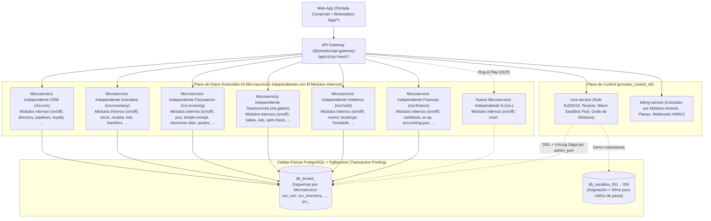

# Proveko — El Servicio SaaS Modular Multi-Tenant de Alto Rendimiento

**Proveko** es **el Servicio empresarial SaaS completo**, multi-tenant y multi-sucursal construido en **100% TypeScript bajo Arquitectura Hexagonal y Principios SOLID**, diseñado para escalar ante tráfico masivo y adaptarse a cualquier giro de negocio mediante una arquitectura abierta de **`N` Microservicios Independientes** que contienen **`M` Módulos Internos** (los cuales se prenden y apagan dinámicamente según la suscripción de cada cliente).

---

## 1. Jerarquía Abierta de 3 Niveles: El Servicio -> `N` Microservicios Independientes -> `M` Módulos (Prender / Apagar)

En **Proveko**, la jerarquía arquitectónica y de negocio se estructura en **3 niveles claros**:

1. **Nivel 1 — El Servicio (La Plataforma SaaS Completa): `Proveko`**
   - Es el sistema empresarial completo integrado por el API Gateway, el Plano de Control (`core-service` + `billing-service`), la aplicación web (`web-app`) y el plano de datos multi-tenant.
2. **Nivel 2 — Los Microservicios Independientes (`ms:<dominio>` | alias `srv:<dominio>`):**
   - **Son los verdaderos microservicios independientes de despliegue y red.** El sistema soporta **`N` Microservicios ilimitados** (ej. `ms:crm`, `ms:inventory`, `ms:invoicing`, `ms:gastro`, `ms:hotel`, `ms:finance`, y cualquier nuevo microservicio futuro como `ms:payroll`, `ms:ecommerce`, `ms:logistics`, `ms:medical`, `ms:<nuevo-dominio>`).
   - Cada Microservicio corre como un servicio independiente (que puede desplegarse en su propio servidor/VPS mediante `UPSTREAM_MS_<DOMINIO>`) y posee su propio esquema de base de datos aislado (`srv_<dominio>` / `ms_<dominio>`).
   - **Regla de Compuerta del Microservicio (Gatekeeper):** Activar únicamente un Microservicio sin ningún módulo interno habilita el contenedor pero no expone pantallas operativas. Es requisito obligatorio que el Microservicio esté activo para poder prender o ejecutar cualquiera de sus Módulos internos; apagar el Microservicio corta en cascada todos sus Módulos.
3. **Nivel 3 — Los Módulos Internos (`mod:<dominio>-<modulo>` | alias `ms:<dominio>-<modulo>`):**
   - **No son servidores independientes.** Viven dentro de su Microservicio y existen para **prender y apagar funcionalidades dinámicamente por cliente/inquilino (Feature & Capability Toggles)**.
   - Controlan qué pantallas, rutas y reglas están activas para cada empresa (`requires`, `mutex_group`, transición automática a modo histórico `READONLY_ARCHIVE` mediante `supersedes`, y cobro granular en la suscripción).
   - Cada Módulo mantiene internamente su código organizado bajo **Arquitectura Hexagonal SOLID** (`domain.ts`, `application.ts`, `infrastructure.ts`, `index.ts`) y su propio prefijo de tablas dentro del esquema de su Microservicio.



---

## 2. Principios SOLID y Arquitectura Hexagonal

Todo el código de los Microservicios y sus Módulos internos cumple los **5 Principios SOLID**:

- **`S` — Single Responsibility Principle (SRP):** Cada módulo interno separa sus responsabilidades en 4 archivos:
  1. `src/domain.ts`: Entidades, Value Objects, cálculos puros con `MoneyDecimal` (`NUMERIC(19,4)`), validaciones de invariantes de negocio y definición del puerto `RepositoryPort`.
  2. `src/application.ts`: Casos de uso (`*UseCases`) que orquestan el dominio recibiendo únicamente la abstracción `RepositoryPort`.
  3. `src/infrastructure.ts`: Adaptadores concretos de persistencia (`InMemory*RepositoryAdapter` / Adaptador SQL multi-tenant aislado por `tenantId`).
  4. `src/index.ts`: Definición del módulo (`defineProvekoModule`) que se monta en el Microservicio.
- **`O` — Open/Closed Principle (OCP):** El sistema está **abierto a la extensión** (agregar nuevos Microservicios Independientes `ms:<dominio>` y nuevos Módulos `mod:<dominio>-<modulo>` para prender/apagar) y **cerrado a la modificación** (sin alterar el motor del API Gateway ni el `DoubleKeyServiceGuard`).
- **`L` — Liskov Substitution Principle (LSP):** Cualquier implementación de `RepositoryPort`, `RateLimiterPort`, `TokenVerifierPort`, `WebhookInboxRepositoryPort` o `UpstreamHttpClientPort` es 100% intercambiable sin alterar las invariantes de salida ni los códigos de error `RFC 9457`.
- **`I` — Interface Segregation Principle (ISP):** Puertos segregados por capacidad (`TokenVerifierPort`, `MonotonicSubVerReader`, `CartStoragePort`, `SubscriptionQuoteCalculatorPort`, `WebhookInboxRepositoryPort`).
- **`D` — Dependency Inversion Principle (DIP):** Ningún caso de uso instancia adaptadores ni estado mutable en memoria directamente; todo depende de interfaces/puertos inyectados por constructor.

---

## 3. Cómo Distribuir los Microservicios en Diferentes Servidores y Cómo Prender/Apagar Módulos

En **Proveko**, la distribución en infraestructura y el control funcional están claramente separados:

1. **Los Microservicios (`ms:<dominio>`) son los que se distribuyen en diferentes servidores:**
   - Puedes correr varios Microservicios en un mismo servidor o asignar un servidor/VPS dedicado a cada Microservicio (`ms:crm`, `ms:inventory`, `ms:invoicing`, `ms:gastro`, `ms:hotel`, `ms:finance`, `ms:<nuevo-dominio>`) configurando su URL en el API Gateway:
     ```bash
     UPSTREAM_MS_CRM=http://10.10.0.10:4000
     UPSTREAM_MS_INVOICING=http://10.10.0.20:4100
     UPSTREAM_MS_INVENTORY=http://10.10.0.30:4200
     UPSTREAM_MS_GASTRO=http://10.10.0.40:4300
     UPSTREAM_MS_HOTEL=http://10.10.0.50:4400
     UPSTREAM_MS_FINANCE=http://10.10.0.60:4500
     ```
2. **Los Módulos (`mod:<dominio>-<modulo>`) viven dentro de su Microservicio y sirven para prenderse y apagarse:**
   - Los módulos **no requieren servidores aparte**: todos los módulos de Facturación viven dentro del Microservicio `ms:invoicing`, todos los de Inventario viven dentro de `ms:inventory`, etc.
   - Cuando un cliente contrata, activa o desactiva un módulo en el Plano de Control (`CatalogCapabilityUseCases`), su versión de suscripción (`sub_ver`) sube atómicamente en PostgreSQL y Redis, y el `DoubleKeyServiceGuard` prende o apaga el acceso a ese módulo en tiempo real (o lo pasa a modo lectura histórica `READONLY_ARCHIVE` si fue reemplazado por un módulo superior).

---

## 4. Cómo Agregar un Nuevo Microservicio (`ms:<dominio>`) o un Nuevo Módulo (`mod:<dominio>-<modulo>`)

1. **Para crear un Nuevo Microservicio Independiente (`ms:<nuevo-dominio>`):**
   - Registrar la clave del nuevo Microservicio y su esquema PostgreSQL (`srv_<nuevo_dominio>`) en `@proveko/shared-kernel`.
   - Crear su carpeta en `apps/srv-<nuevo-dominio>` con su `host-runner` y su `README.md`.
   - Apuntar su servidor en el API Gateway mediante `UPSTREAM_MS_<NUEVO_DOMINIO>`.
2. **Para agregar un Nuevo Módulo Activable/Desactivable (`mod:<dominio>-<nuevo-modulo>`) dentro de un Microservicio:**
   - Registrar el módulo en el catálogo indicando a qué Microservicio pertenece (`parentService`), su prefijo de tablas, sus dependencias (`requires`), su grupo de exclusión (`mutex_group`) y si reemplaza a otro módulo (`supersedes`).
   - Crear la carpeta del módulo con sus 4 capas Hexagonales SOLID (`domain.ts`, `application.ts`, `infrastructure.ts`, `index.ts`) y montarlo en el `host-runner` de su Microservicio.

---

## 5. Mapa del Monorepo y Catálogo Base Inicial (Extensible a `N` Microservicios y `M` Módulos)

### Anillo 0 — Librerías Compartidas (`/libs/*`)
- `@proveko/shared-kernel`: Catálogo dinámico del grafo (`ms:*` y `mod:*`), `MoneyDecimal` aislado con `Decimal.clone`, claims JWT y errores `RFC 9457`.
- `@proveko/crypto-vault`: Sobre criptográfico `KEK + DEK` (`AES-256-GCM`) y firma/verificación `Ed25519`.
- `@proveko/service-guard`: Guard Zero-Trust de Doble Llave (`TokenVerifierPort`) que verifica si el Microservicio y el Módulo están prendidos para el cliente.
- `@proveko/tenant-db-resolver`: Esquemas explícitos `pgSchema('srv_*')` y micro-pools LRU libres de condiciones de carrera con *Graceful Drain*.
- `@proveko/event-bus`: Patrón Transactional Outbox Híbrido + Transactional Inbox idempotente.
- `@proveko/rules-engine`: Validador anti-JSONB Bomb y protección anti-SSRF (incluyendo IPv4-mapped IPv6 `::ffff:*`) para Webhooks.
- `@proveko/ui-kit`: Reconciliador resiliente del carrito POS cuando un módulo se prende o apaga en caliente (`sub_ver`).

### Anillo 1 — Gateway, Plano de Control y Frontend (`/apps/*`)
- [API Gateway (`apps/api-gateway`)](./apps/api-gateway/README.md)
- [Core Service (`apps/control-plane/core-service`)](./apps/control-plane/core-service/README.md)
- [Billing Service (`apps/control-plane/billing-service`)](./apps/control-plane/billing-service/README.md)
- [Web App (`apps/web-app`)](./apps/web-app/README.md)

### Anillo 2 — Catálogo Base Inicial de Microservicios Independientes y sus Módulos Internos (On/Off)

> **Nota de Extensibilidad:** La siguiente tabla muestra el catálogo base inicial incluido en el monorepo; el sistema admite agregar `N` nuevos Microservicios Independientes (`ms:<dominio>`) y `M` nuevos Módulos internos (`mod:<dominio>-<modulo>`).

| Microservicio Independiente (`ms:*` / `srv:*`) | Esquema BD | Módulos Internos (Prender / Apagar: `mod:*` / `ms:*`) | Prefijo Tablas | Documentación |
| :--- | :--- | :--- | :---: | :--- |
| **[`ms:crm`](./apps/srv-crm/README.md)** | `srv_crm` | `mod:crm-directory` | `dir_` | [Ver Módulo](./apps/srv-crm/ms-crm-directory/README.md) |
| | `srv_crm` | `mod:crm-pipelines` | `pip_` | [Ver Módulo](./apps/srv-crm/ms-crm-pipelines/README.md) |
| | `srv_crm` | `mod:crm-loyalty` | `loy_` | [Ver Módulo](./apps/srv-crm/ms-crm-loyalty/README.md) |
| **[`ms:inventory`](./apps/srv-inventory/README.md)** | `srv_inventory` | `mod:inventory-stock` | `stk_` | [Ver Módulo](./apps/srv-inventory/ms-inventory-stock/README.md) |
| | `srv_inventory` | `mod:inventory-recipes` | `rec_` | [Ver Módulo](./apps/srv-inventory/ms-inventory-recipes/README.md) |
| | `srv_inventory` | `mod:inventory-lots` | `lot_` | [Ver Módulo](./apps/srv-inventory/ms-inventory-lots/README.md) |
| | `srv_inventory` | `mod:inventory-transfers` | `trf_` | [Ver Módulo](./apps/srv-inventory/ms-inventory-transfers/README.md) |
| **[`ms:invoicing`](./apps/srv-invoicing/README.md)** | `srv_invoicing` | `mod:invoicing-pos` | `pos_` | [Ver Módulo](./apps/srv-invoicing/ms-invoicing-pos/README.md) |
| | `srv_invoicing` | `mod:invoicing-simple-receipt` | `rcp_` | [Ver Módulo](./apps/srv-invoicing/ms-invoicing-simple-receipt/README.md) |
| | `srv_invoicing` | `mod:invoicing-electronic-dian` | `dian_` | [Ver Módulo](./apps/srv-invoicing/ms-invoicing-electronic-dian/README.md) |
| | `srv_invoicing` | `mod:invoicing-quotes` | `quo_` | [Ver Módulo](./apps/srv-invoicing/ms-invoicing-quotes/README.md) |
| **[`ms:gastro`](./apps/srv-gastro/README.md)** | `srv_gastro` | `mod:gastro-tables` | `tbl_` | [Ver Módulo](./apps/srv-gastro/ms-gastro-tables/README.md) |
| | `srv_gastro` | `mod:gastro-kds` | `kds_` | [Ver Módulo](./apps/srv-gastro/ms-gastro-kds/README.md) |
| | `srv_gastro` | `mod:gastro-split-check` | `spl_` | [Ver Módulo](./apps/srv-gastro/ms-gastro-split-check/README.md) |
| **[`ms:hotel`](./apps/srv-hotel/README.md)** | `srv_hotel` | `mod:hotel-rooms` | `rom_` | [Ver Módulo](./apps/srv-hotel/ms-hotel-rooms/README.md) |
| | `srv_hotel` | `mod:hotel-bookings` | `bkg_` | [Ver Módulo](./apps/srv-hotel/ms-hotel-bookings/README.md) |
| | `srv_hotel` | `mod:hotel-frontdesk` | `fdk_` | [Ver Módulo](./apps/srv-hotel/ms-hotel-frontdesk/README.md) |
| **[`ms:finance`](./apps/srv-finance/README.md)** | `srv_finance` | `mod:finance-cashbook` | `csh_` | [Ver Módulo](./apps/srv-finance/ms-finance-cashbook/README.md) |
| | `srv_finance` | `mod:finance-ar-ap` | `arp_` | [Ver Módulo](./apps/srv-finance/ms-finance-ar-ap/README.md) |
| | `srv_finance` | `mod:finance-accounting-puc` | `puc_` | [Ver Módulo](./apps/srv-finance/ms-finance-accounting-puc/README.md) |
| **`ms:<nuevo-dominio>`** | `srv_<nuevo_dominio>` | `mod:<nuevo-dominio>-<modulo>` | `<pref>_` | *Extensible mediante `defineProvekoModule` (OCP)* |

---

## 6. Arquitectura Multi-Base de Datos por Cliente (`Base A`, `Base B`, `Base C`, `Base D`): Complejidad Técnica y Operación

En `@proveko/tenant-db-resolver` están implementados los **6 pilares** necesarios para operar un **Backend Único** frente a múltiples bases de datos aisladas por cliente:

### A. Complejidad Técnica (`libs/tenant-db-resolver`)
1. **Conexiones Dinámicas (`TenantConnectionPoolManager`):**
   - Abre y administra micro-pools bajo demanda hacia `Base A`, `Base B`, `Base C`, `Base D` con presupuesto estricto de sockets por plan, deduplicación *Single-Flight* y cierre limpio (*Graceful Drain*) al expulsar de la caché LRU.
2. **Routing por Cliente (`RoutingEnvelopeProviderPort` + `EnvelopeCryptoVault`):**
   - Resuelve en cada petición a qué Celda física (`cellId`) y a qué base de datos (`db_tenant_<id>`) pertenece el cliente tomando su contexto firmado en `AsyncLocalStorage` y descifrando sus credenciales con `AES-256-GCM` + `AAD`.
3. **Migraciones Múltiples Separadas en 2 Carpetas (`migrations/core` vs `migrations/clients`):**
   - **`libs/tenant-db-resolver/migrations/core/`:** Archivos `.sql` exclusivos de la Base Principal (`proveko_control_db` / `coreDB`, donde vive la tabla `control_plane.tenants` con la lista maestra de clientes y sus BDs).
   - **`libs/tenant-db-resolver/migrations/clients/<microservicio>/<modulo>/`:** Archivos `.sql` numerados secuencialmente (`0001_init_*.sql`, `0002_add_*.sql`) que se aplican a `db_version_prueba` y a cada `db_tenant_<cliente>`.
   - **Control de Versiones por Tabla `schema_migrations` + Checksum `SHA-256`:** La tabla `srv_<microservicio>.schema_migrations` dentro de cada base de datos lleva el control exacto de qué archivos `.sql` ya fueron aplicados, saltando las migraciones antiguas (`skippedOldMigrations`), validando su `checksum_sha256` (`409 ERR_MIGRATION_CHECKSUM_DRIFT` si fueron alteradas) y ejecutando únicamente las nuevas en transacción DDL (`BEGIN ... COMMIT`) bajo `pg_advisory_lock`.

### B. Operación (`libs/tenant-db-resolver/src/tenant-db-operations.manager.ts`)
4. **Backups por Cliente (`PerTenantBackupManager`):**
   - Genera y restaura snapshots individuales por base de datos (`Base A` sin tocar a `Base B`, `Base C` ni `Base D`), firmados con `SHA-256` e incluyendo el estado exacto de las migraciones aplicadas y puesta al día automática (*catch-up*) tras restaurar.
5. **Monitoreo por Base (`PerDatabaseHealthAndAlertMonitor`):**
   - Evalúa métricas individuales por cada base de datos (`queryLatencyP95Ms`, `connectionUtilizationPercent`, `storageUtilizationPercent`, `migrationStatus`, `lastBackupAtIso`).
6. **Alertas más Finas (`GranularDatabaseAlert`):**
   - Dispara alertas específicas por base de datos individual (`HIGH_QUERY_LATENCY`, `CONNECTION_POOL_SATURATION`, `STORAGE_QUOTA_THRESHOLD`, `MIGRATION_FAILURE_OR_DRIFT`, `BACKUP_OVERDUE`) identificando exactamente qué cliente (`Base A`, `Base B`, `Base C` o `Base D`) requiere atención.

---

## 7. Despliegue Multi-Contenedor de Microservicios en ALpanel (`ServerPanel`)

El repositorio incluye en su raíz `docker-compose.yml`, `Dockerfile` y `.env.example` siguiendo las reglas de **ALpanel** para que la plataforma corra como **contenedores de microservicios independientes** (nunca como monolito):

| Contenedor en ALpanel | Rol en el Cluster | Puerto Interno / Externo | Responsabilidad |
| :--- | :--- | :--- | :--- |
| **`proveko_db`** | `db` (`postgres:16-alpine`) | `${DB_EXTERNAL_PORT:-5432}:5432` | Aloja `proveko_control_db` y las bases independientes por cliente (`Base A`, `Base B`, `Base C`, `Base D`...) en el volumen persistente `postgres_data`. |
| **`proveko_frontend`** | `frontend` | `${FRONTEND_PORT:-5173}:5173` | Interfaz web Workstation vinculable al dominio principal en **Dominios & SSL** de ALpanel. |
| **`proveko_api_gateway`** | `api-gateway` | `${BACKEND_PORT:-4000}:4000` | Puerta perimetral Zero-Trust (`BACKEND_PORT`) que valida Doble Llave Ed25519 y enruta por red hacia cada contenedor de microservicio. |
| **`proveko_core_service`** | `core-service` | `:4010` (red interna) | Plano de control, catálogo de servicios/módulos y registro de las migraciones `.sql`. |
| **`proveko_ms_crm`** | `ms:crm` (`ms-host-runner`) | `:4101` (red interna) | Contenedor independiente del Microservicio CRM (`mod:crm-directory`, `mod:crm-pipelines`, `mod:crm-loyalty`). |
| **`proveko_ms_inventory`** | `ms:inventory` (`ms-host-runner`) | `:4102` (red interna) | Contenedor independiente del Microservicio de Inventario (`mod:inventory-stock`, `mod:inventory-recipes`, `mod:inventory-lots`, `mod:inventory-transfers`). |
| **`proveko_ms_invoicing`** | `ms:invoicing` (`ms-host-runner`) | `:4103` (red interna) | Contenedor independiente del Microservicio de Facturación (`mod:invoicing-pos`, `mod:invoicing-simple-receipt`, `mod:invoicing-electronic-dian`, `mod:invoicing-quotes`). |
| **`proveko_ms_gastro`** | `ms:gastro` (`ms-host-runner`) | `:4104` (red interna) | Contenedor independiente del Microservicio Gastronómico (`mod:gastro-tables`, `mod:gastro-kds`, `mod:gastro-split-check`). |
| **`proveko_ms_hotel`** | `ms:hotel` (`ms-host-runner`) | `:4105` (red interna) | Contenedor independiente del Microservicio Hotelero (`mod:hotel-rooms`, `mod:hotel-bookings`, `mod:hotel-frontdesk`). |
| **`proveko_ms_finance`** | `ms:finance` (`ms-host-runner`) | `:4106` (red interna) | Contenedor independiente del Microservicio Financiero (`mod:finance-cashbook`, `mod:finance-ar-ap`, `mod:finance-accounting-puc`). |

* **Escalado a múltiples servidores VPS desde ALpanel:** Si cualquiera de los microservicios (`ms:invoicing`, `ms:inventory`, etc.) requiere su propio VPS dedicado por alto tráfico, basta con cambiar su variable `UPSTREAM_MS_<DOMINIO>` en el editor visual `.env` de ALpanel y presionar **`Restart Docker`**.

---

## 8. Comandos de Migraciones (`core` vs `clients`), Desarrollo y Verificación

```bash
# 1. Generar un nuevo archivo de migración para la Base Principal (migrations/core/NNNN_nombre.sql)
npm run db:make:core -- add_billing_audit_log

# 2. Generar un nuevo archivo de migración para las Bases de Clientes (migrations/clients/<srv>/<ms>/NNNN_nombre.sql)
npm run db:make:client -- ms:invoicing mod:invoicing-pos add_pos_cashier_shift

# 3. Ejecutar migraciones únicamente sobre la Base Principal (proveko_control_db / coreDB)
npm run db:migrate:core

# 4. Ejecutar migraciones MASIVAS sobre todas las BDs de clientes registradas en coreDB
npm run db:migrate:clients

# 5. Ejecutar migración LOCALIZADA en 1 sola BD específica (opcionalmente filtrando por 1 módulo)
npm run db:migrate:client -- --db=db_version_prueba --module=mod:invoicing-pos

# 6. Levantar todos los contenedores independientes de microservicios (estándar ALpanel)
docker compose up -d --build

# 7. Verificación estricta de tipos TypeScript y suite completa de pruebas (Vitest)
npm run typecheck
npm test
```
